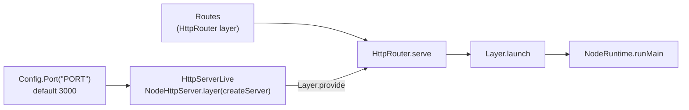

# Server runtime

[`src/server.ts`](../../src/server.ts) is both the route module and the process
entry point. The server starts only when the file is run directly
(`import.meta.main`), so tests can import `Routes` without opening a port.

## Startup composition

- `HttpServerLive` is a `Layer.unwrap` over an Effect that reads the port and
  returns `NodeHttpServer.layer` from `@effect/platform-node`, backed by Node's
  `node:http` `createServer`.
- `HttpRouter.serve(Routes)` is provided with `HttpServerLive`, turned into a
  long-running program with `Layer.launch`, and run with
  `NodeRuntime.runMain`, which owns process lifecycle and signal handling.

## Configuration

| Variable | Read through                | Default | Effect                  |
| -------- | --------------------------- | ------- | ----------------------- |
| `PORT`   | `Config.Port("PORT")`       | `3000`  | TCP port the server binds |

`Config.Port` validates the value as a port number; an invalid `PORT` fails
startup through Effect's config error rather than falling back to the default.
There are no other configuration surfaces, persistence, or external
integrations.

## Running

| Command        | Behavior                                   |
| -------------- | ------------------------------------------ |
| `npm start`    | `tsx src/server.ts`, runs the server once  |
| `npm run dev`  | `tsx watch src/server.ts`, restarts on change |

TypeScript is executed directly by `tsx`; nothing is compiled to disk. See
[../tooling/toolchain.md](../tooling/toolchain.md).
